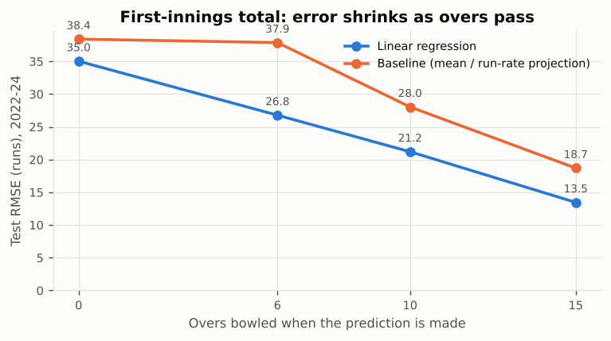
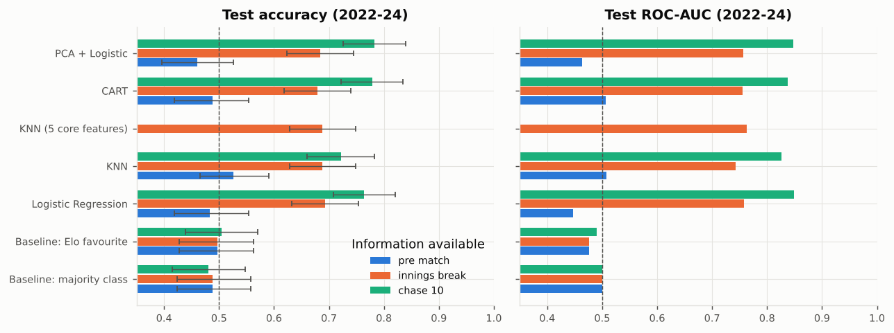
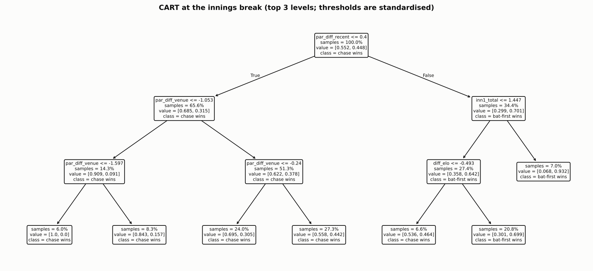
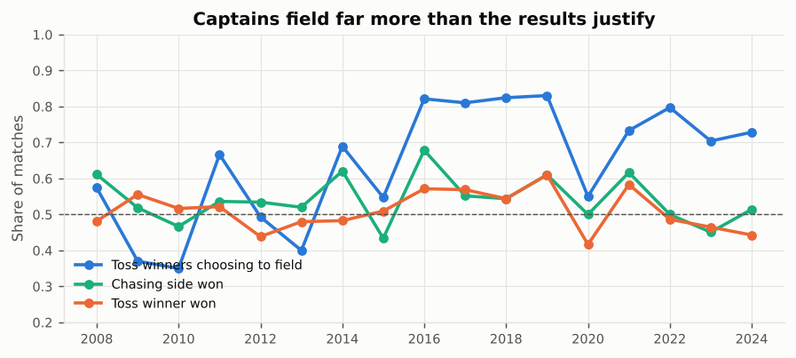
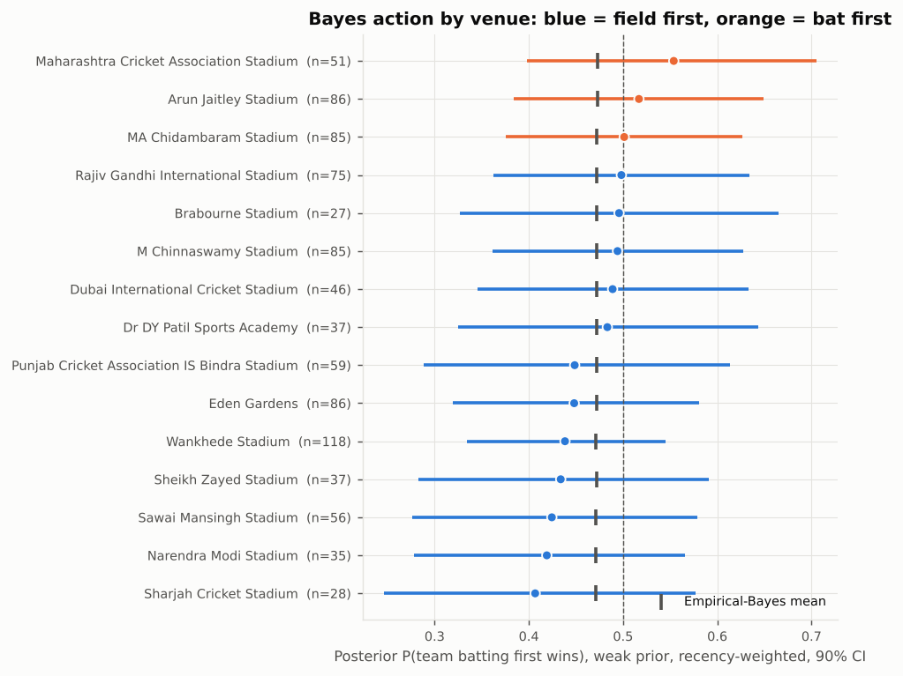
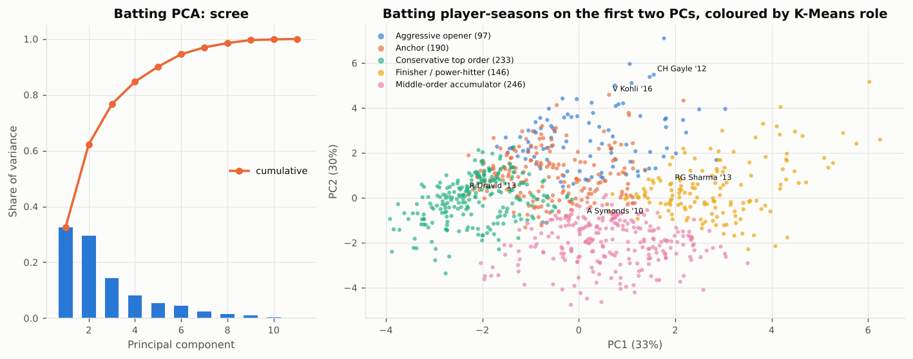
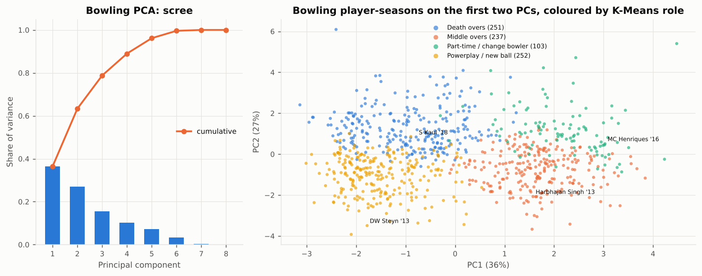

# IPL Match & Player Analytics: model results

Data: Kaggle IPL, 2008–2024 (1,095 matches, 260,759 balls). Models use the 1,061 **usable** matches: decided, full 20 overs, no D/L.
Protocol: **train on 2008–2021, test on 2022–2024** (213 matches). Hyper-parameters are tuned with 5-fold GroupKFold over training seasons. All numbers below are on the test seasons unless marked "train".
Reproduce with `./run_all.sh` (about 70 s). Every figure is in `results/figures/` and every table in `results/`.

---

## 1. First-innings total: linear regression (Q1, Objective ii)

| Prediction made at | Linear regression RMSE | MAE | R² | Baseline | Baseline RMSE |
|---|---|---|---|---|---|
| Pre-match | 35.0 | 27.3 | −0.09 | train mean | 38.4 |
| 6 overs | 26.8 | 21.5 | 0.37 | run-rate projection | 37.9 |
| 10 overs | **21.2** | 16.8 | **0.60** | run-rate projection | 28.0 |
| 15 overs | **13.5** | 10.4 | **0.84** | run-rate projection | 18.7 |

**Which factors explain the total.** These are standardised OLS coefficients on the training seasons, in runs per +1 SD of the feature.

- **At 10 overs:** runs so far (+14.1) and wickets lost (−8.1) dominate. Both have p < 0.001.
- **Wickets × run rate:** the interaction is significant (−3.1, p < 0.001). The wickets term is negative because losing wickets reduces how much of the current run rate the team can keep up.
- **Smaller effects:** batting at home (+1.9, p = 0.009) and playoff matches (+1.8, p = 0.01).
- **Permutation importance on test** gives the same ranking: shuffling runs-at-10 adds 11.7 runs of RMSE and wickets add 4.2. Every other feature adds less than 0.5.
- **Pre-match**, only home advantage (+3.6, p < 0.001), batting-lineup strike rate and opposition bowling economy (both p < 0.05) matter. Venue average is not significant once the other features are included.

**Era shift.** The model under-predicts recent seasons. Its mean error at 6 overs is +4.7 runs in 2022, +5.9 in 2023 and +10.4 in 2024. This is the Impact Player rule (from 2023) pushing totals up. The rolling "recent league average" feature only partly corrects for it. A season-specific intercept, or retraining each season, would fix it.

## 2. Winner prediction: Logistic Regression, KNN, CART and PCA + Logistic (Q2, Q5, Objective iii)

Target: did the team batting first win? Accuracy is shown with a bootstrap 95% CI.

| Information available | Best model | Accuracy | ROC-AUC | Brier | Baselines (majority / Elo) |
|---|---|---|---|---|---|
| Pre-match (after toss) | KNN | 0.53 (0.47–0.59) | 0.51 | 0.254 | 0.49 / 0.50 |
| Innings break | Logistic Regression | **0.69** (0.63–0.75) | 0.76 | 0.207 | 0.49 / 0.50 |
| Chase after 10 overs | PCA + Logistic | **0.78** (0.73–0.84) | 0.85 | 0.158 | 0.48 / 0.51 |

Full table: `results/winner_model_comparison.csv`.

**Ranked comparison**

- **At the innings break**, all four model families are within 1.5 accuracy points, which is well inside the CI. Logistic Regression wins on accuracy, KNN on 5 core features wins on AUC (0.762), and CART wins on Brier score (0.202). The data cannot separate them.
- **Before the match, no model beats a coin flip.** Training-season CV AUCs were 0.50–0.55, and on test every CI includes 50%.
  - On the training seasons, the logistic model finds home advantage (odds ratio 1.22 per SD, p = 0.02) and the Elo difference (OR 1.26, p = 0.08). These are real but weak, and they do not carry over to 2022–24.
  - IPL squads are deliberately balanced by the auction and player retention rules. This is a substantive finding, not a modelling failure.
- **After the first innings**, the total dominates (OR 3.08 per SD, p < 0.001). The tree's top split is "first-innings total vs the recent league average", and the next split is the total vs the venue average. Effectively the model asks whether the score is above par.

**KNN and similarity.** KNN on all 21 features (AUC 0.743) does worse than KNN on 5 match-state features (AUC 0.762). Weak pre-match features add noise to the distance measure. For example, the 5 matches most similar to the 2024 final (SRH 113 all out) were all low first-innings totals of 101–112. In every one, the chasing side won, giving P(bat-first wins) = 0.12. See `results/knn_similar_matches.txt`.

**PCA + Logistic** matches plain logistic regression with only 2 components at the innings break (AUC 0.756). Almost all of the signal sits in one or two directions.

## 3. Toss, venue and winning (Q3)

| Test | Result |
|---|---|
| Toss winner wins | 50.7% of 1,061 matches (binomial p = 0.67). **No overall toss advantage** |
| Toss winner wins, by decision | Chose to field: 53.6%. Chose to bat: 45.5% (χ² p = 0.014) |
| Toss winner wins, by team | Differs by team (χ² p = 0.010): CSK 62%, PBKS 41%, Pune Warriors 15%. This mostly reflects how strong each team is |
| Home advantage | Home side wins 54.6% of 691 home-vs-away matches (p = 0.018) |
| Does the decision's effect depend on venue? | Logistic regression likelihood-ratio test: χ²(13) = 12.3, **p = 0.50**. No venue × decision interaction |
| Has it changed by era (2008–14, 2015–19, 2020–24)? | χ²(2) = 0.31, p = 0.86 |

## 4. Bayesian bat-or-field decision (Q4, Objective iv)

For each venue v, let p_v = P(team batting first wins). Matches are recency-weighted with a half-life of 4 seasons. The model is p_v ~ Beta(α₀, β₀) and wins ~ Binomial(n_v, p_v).

The decision uses expected win probability: E[win | bat] = E[p_v | data] and E[win | field] = 1 − E[p_v | data]. Under 0-1 loss, the Bayes action is whichever is larger.

- **Empirical-Bayes prior** (fitted to how much venues actually differ): the between-venue variance is no larger than binomial noise. The fitted prior is therefore worth about 2,500 pseudo-matches, and every venue shrinks to the league mean of 0.47. **The Bayes action is "field" at every venue.** This agrees with the p = 0.50 interaction test above.
- **Weak prior** (10 pseudo-matches), which lets each venue's own data speak: 12 of the 15 main venues favour fielding. Sharjah, Narendra Modi Stadium and Wankhede lean most strongly, with P(field better) = 0.82–0.83. MCA Pune, Arun Jaitley and Chepauk lean slightly towards batting. Every 90% credible interval crosses 0.5.

**Back-test over 2015–24** (618 matches, each season using only earlier data):

| Rule | Toss winner wins if they follow the rule | ... if they ignore it | Side in the recommended role won |
|---|---|---|---|
| Empirical Bayes (always field) | 53.6% (n = 455) | 46.0% (n = 163), χ² p = 0.11 | 53.7% |
| Weak prior (venue-specific) | 52.7% (n = 440) | 48.9% (n = 178), p = 0.44 | 52.3% |

**Answer to Q4:** yes, a decision can be made, and the data-supported one is **"field first" at essentially every venue**, with an edge of about 3–4 points.

- The venue-specific rule does slightly *worse* than "always field". The venue differences in the data look like noise, not real effects.
- Since 2015, captains have chosen to field 74% of the time. The remaining "bat first" decisions underperform: 45.5% wins vs 53.6% when fielding.

## 5. PCA and player-role clustering (Q5, Objectives v–vii)

**Setup**
- **Batting:** 912 player-seasons with ≥100 balls faced, 11 features. Rate stats are divided by that season's median so that 2008 and 2024 scoring rates are comparable.
- **Bowling:** 843 player-seasons with ≥120 balls bowled, 8 features.
- Features are standardised, then clustered with K-Means and with Ward hierarchical clustering. Clusters are **named by fixed rules on their centroids**, never by hand. Each player gets their modal role across seasons, weighted by balls.

**PCA**
- **Batting:** PC1 (33%) is *batting position*: late entry and death-overs share, against powerplay share and dot-ball %. PC2 (30%) is *quality and aggression*: boundary %, strike rate, average and balls per innings all load positively.
- **Bowling:** PC1 (36%) is *phase*: middle-overs share against powerplay and death share. PC2 (27%) is *cost*: economy and boundaries conceded vs dot-ball %.
- Five components explain 90% of the variance in both cases. Clustering on those 5 PCs gives almost the same result as clustering on the raw features (ARI 0.94 batting, 0.99 bowling).

**Batting roles (k = 5)**

| Role | Player-seasons | Average | Strike rate | Entry (balls bowled when they come in) | Powerplay share | Death share |
|---|---|---|---|---|---|---|
| Aggressive opener | 97 | 34.8 | 158 | 15 | 0.47 | 0.07 |
| Anchor | 190 | 42.2 | 133 | 17 | 0.36 | 0.12 |
| Conservative top order | 233 | 24.7 | 123 | 9 | 0.58 | 0.05 |
| Finisher / power-hitter | 146 | 36.7 | 152 | 67 | 0.05 | 0.43 |
| Middle-order accumulator | 246 | 24.3 | 123 | 59 | 0.11 | 0.32 |

**Bowling roles (k = 4)**

| Role | Player-seasons | Economy | Powerplay / middle / death share of overs | Overs per innings |
|---|---|---|---|---|
| Powerplay / new ball | 252 | 7.43 | 0.54 / 0.21 / 0.25 | 3.6 |
| Middle overs (mostly spin) | 237 | 7.30 | 0.13 / 0.72 / 0.15 | 3.5 |
| Death overs | 251 | 9.08 | 0.34 / 0.33 / 0.34 | 3.5 |
| Part-time / change bowler | 103 | 8.47 | 0.13 / 0.73 / 0.14 | 2.7 |

**Comparison with known roles (Objective vii).** 39 batters and 31 bowlers were hand-labelled from common cricket knowledge; see `REF_BAT` / `REF_BOWL` in `src/player_roles.py`.

| | K-Means agreement | Ward agreement | ARI vs labels | K-Means vs Ward ARI | Silhouette |
|---|---|---|---|---|---|
| Bowling | **90%** (28/31) | 55% | 0.78 | 0.53 | 0.23 |
| Batting (era-adjusted) | **69%** (27/39) | 74% | 0.55 | 0.43 | 0.19 |
| Batting (not era-adjusted) | 62% | – | 0.50 | – | 0.21 |

- **Bowling roles come out cleanly.** All 13 middle-overs bowlers are placed correctly. The 3 misses are a fair argument: Malinga lands in "powerplay" and Siraj and Umesh in "death".
- **Batting roles are less sharply separated.** All 12 anchors are correct. 9 of 13 finishers are correct; Pandya, Karthik, Shahrukh Khan and Abdul Samad land in "middle-order accumulator" because many of their seasons were lower-scoring. Openers are the weak spot for K-Means: only 6 of 14 are correct. Warner and Ishan Kishan come out as anchors on volume, and Shaw, McCullum, de Kock and Bairstow as "conservative top order". Ward clustering places most of these as aggressive openers, which is why its overall batting agreement is higher (74%).
- **The roles form a continuum.** Silhouette scores of about 0.2 mean the roles shade into each other rather than forming distinct groups. Cluster *names* line up with reality well, but individual player-seasons near the boundaries move between clusters, and K-Means and Ward disagree on many of them (ARI about 0.5).
- The reference labels are a judgement call. Review them and add more before quoting these numbers as final.

## 6. Answers to the core questions

1. **First-innings total:** after 10 overs it's mainly runs and wickets so far, plus their interaction. Home advantage and lineup strength add a little. Venue average adds little once those are in. RMSE drops from 35 runs pre-match to 13.5 at 15 overs.
2. **Winner:** about 50% pre-match (no better than chance on unseen seasons), 69% at the innings break, 78% after 10 overs of the chase.
3. **Team, venue, toss and winning:** the toss itself gives no edge. *Fielding* after winning it does (53.6% vs 45.5%), and so does playing at home (54.6%). There is no evidence that the toss effect differs by venue or era.
4. **Bat or field:** the Bayes action is field first, and the per-venue differences don't survive shrinkage.
5. **Player roles:** yes for bowlers (90% agreement with known roles). Mostly for batters (69%), with fuzzy boundaries between roles.

**Most important factors for predicting the winner (Expected Outcome 5):** first-innings total relative to par (both the recent league average and the venue average), the chase state (runs needed and wickets lost), then Elo difference and home advantage, which are weak.
